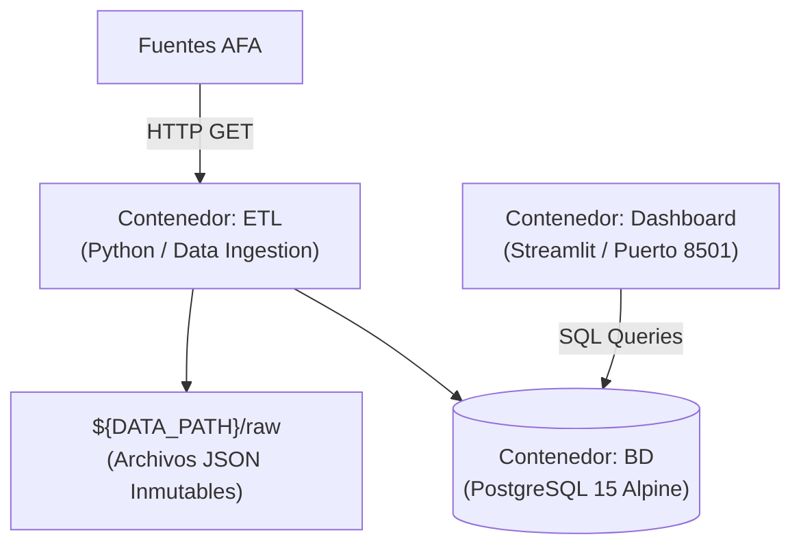

# MoneyBall Argentino / Argos

Plataforma integral de ingeniería de datos, almacenamiento estructurado y análisis deportivo aplicada al fútbol argentino (Primera División).

---

## 1. Visión y Objetivos del Proyecto

* **Objetivo Técnico:** Diseñar un pipeline de datos robusto, reproducible e idempotente ejecutado sobre un servidor local dedicado (Argos) o entornos de desarrollo contenerizados, aplicando buenas prácticas de desarrollo en Linux, Docker, Python y PostgreSQL.
* **Objetivo de Dominio / Scouting:** Ingerir, normalizar y explotar datos del fútbol argentino para responder preguntas tácticas y de mercado (detección de talento sub-23, métricas de rendimiento por 90 minutos y comparativas directas entre jugadores).

---

## 2. Arquitectura del Sistema

El sistema se ejecuta como una plataforma multicontenedor orquestada mediante Docker Compose (Compose Specification).



---

## 3. Especificación de Contenedores

| Servicio / Contenedor | Stack Base | Puerto | Rol y Responsabilidades |
| :--- | :--- | :--- | :--- |
| **etl** | Python 3.11+ / httpx / pydantic / sqlalchemy | N/A (Worker / CLI) | - Realiza fetch hacia los endpoints de AFA.<br>- Guarda respuestas crudas e inmutables con timestamp y hash SHA256 en `${DATA_PATH}/raw`.<br>- Ejecuta validaciones de contrato de datos (*Data Contracts*) con Pydantic v2.<br>- Transforma y aplana estructuras anidadas a esquemas relacionales.<br>- Inserta/actualiza datos de forma idempotente (*Upsert*) en PostgreSQL. |
| **postgres** | PostgreSQL 15 Alpine | 5432:5432 | - Persiste la capa analítica (*Silver Layer*).<br>- Almacena tablas normalizadas (`players`, `teams`, `stats`).<br>- Mantiene índices optimizados (btree) para consultas analíticas de baja latencia.<br>- Guarda el payload original en columnas `JSONB` para auditoría y trazabilidad. |
| **streamlit** | Streamlit / Python | 8501:8501 | - Consume vistas y consultas SQL optimizadas desde PostgreSQL.<br>- Expone visualmente métricas de scouting (filtros por edad, posición, métricas por 90 min).<br>- Proporciona la interfaz interactiva para análisis exploratorio. |

---

## 4. Estructura de Directorios

El proyecto soporta tanto ejecución en servidor dedicado (Argos) como en estaciones de trabajo locales gracias a la abstracción de almacenamiento (`DATA_PATH`):

```text
moneyball-argentino/             # Repositorio Git del proyecto
├── docker-compose.yml           # Orquestación de servicios contenerizados
├── Dockerfile                   # Imagen base compartida (Python 3.11-slim + dependencias)
├── .env.example                 # Plantilla de variables de entorno documentadas
├── .env                         # Configuración activa del entorno (ignorado en Git)
├── requirements.txt             # Dependencias Python fijadas y clasificadas
├── sql/
│   └── schema.sql               # DDL y esquema relacional de PostgreSQL
├── scripts/
│   └── dashboard.py             # Aplicación interactiva de Streamlit
├── data/                        # Almacenamiento local (ignorado en Git, solo .gitkeep)
│   ├── raw/                     # Snapshots inmutables JSON (Bronze Layer)
│   ├── processed/               # Datos intermedios limpios (si aplica)
│   └── database/                # Datos persistentes de PostgreSQL (volumen)
└── logs/                        # Logs de ejecución y cuarentena del pipeline
```

---

## 5. Pipeline de Ejecución del ETL

1. **Extract (`extract.py`):** Descarga el endpoint de AFA (ej. `playersStatsFull.json`), calcula hash SHA-256 de integridad y escribe el archivo crudo inmutable con timestamp UTC en `${DATA_PATH}/raw/`.
2. **Contract Validation (`schemas.py`):** Pydantic v2 valida la estructura del payload contra contratos estrictos para prevenir inconsistencias en la base de datos si la fuente remota cambia sus campos (*breaking changes*). Implementa política de cuarentena para aislar registros corruptos.
3. **Transform (`transform.py`):** Desanida objetos (`name.first`, `name.last`), castea fechas a `DATE`, maneja valores nulos y estandariza métricas numéricas.
4. **Load (`load.py`):** Ejecuta operaciones de inserción/actualización idempotentes basadas en `player_id` mediante cláusulas `ON CONFLICT (player_id) DO UPDATE`, preservando el payload crudo en `JSONB`.

---

## 6. Requisitos Previos del Sistema

Para clonar y ejecutar este proyecto en tu entorno local se requiere:

* **Sistema Operativo:** Linux (probado en Debian / Ubuntu), macOS o Windows con WSL2.
* **Docker Engine:** Versión 24.0+ recomendada.
* **Docker Compose:** Versión v2.20+ (integrado nativamente como `docker compose`).
* **Python (Opcional):** Versión 3.11+ si se desea interactuar o ejecutar scripts fuera del contenedor.

### Verificación de Instalación
```bash
docker --version
docker compose version
```

---

## 7. Puesta en Marcha Rápida (Local Quickstart)

### 1. Clonar el repositorio y acceder
```bash
git clone https://github.com/Juan-Gonzalez04/moneyball-argentino.git
cd moneyball-argentino
```

### 2. Configurar Variables de Entorno
Copia la plantilla `.env.example` a `.env`:
```bash
cp .env.example .env
```

> [!NOTE]
> **Gestión de Almacenamiento (`DATA_PATH`):**
> * En **desarrollo local (laptop/workstation)**, mantén `DATA_PATH=./data`. Docker creará y persistirá los volúmenes dentro de la carpeta del proyecto.
> * En el servidor de producción **Argos (bare-metal)**, configura `DATA_PATH=/data/scouting` para aprovechar el disco masivo de 2 TB montado en `/data`.

### 3. Construir y Levantar los Contenedores
```bash
docker compose up -d --build
```

### 4. Verificar el Estado de los Servicios
```bash
docker compose ps
```
Los tres servicios (`afa-postgres`, `afa-etl`, `afa-streamlit`) deben figurar en estado `running` o `Up`.

### 5. Acceso al Dashboard
Una vez iniciados los servicios, accede al explorador de scouting en:
* URL: `http://localhost:8501`

---

## 8. Stack Tecnológico y Dependencias

| Dependencia | Rol en el Proyecto | Justificación Técnica |
| :--- | :--- | :--- |
| **Docker & Compose** | Infraestructura y Reproducibilidad | Aislar dependencias, garantizar paridad total entre la notebook de desarrollo y el servidor Argos. |
| **PostgreSQL 15 (Alpine)** | Motor Relacional / Almacén Analítico | Integridad referencial ACID, soporte de tipos nativos `JSONB` y optimización con funciones de ventana (*Window Functions*). |
| **Pydantic (v2)** | Data Contracts & Validación | Tipado estricto en tiempo de ejecución; garantiza que ningún registro malformado corrompa la base analítica. |
| **HTTPX** | Cliente HTTP | Cliente moderno con soporte síncrono y asíncrono, gestión granular de timeouts, reintentos y sesiones. |
| **SQLAlchemy Core / Psycopg2** | Conectividad y Ejecución Batch | Inserciones masivas eficientes y ejecución de sentencias Upsert nativas (`ON CONFLICT`). |
| **Pandas** | Análisis Vectorizado | Manipulación de dataframes para cálculos de percentiles y rankings. |
| **Streamlit** | Capa de Presentación | Desarrollo ágil de dashboards analíticos reactivos sin sobrecarga de frameworks frontend pesados. |